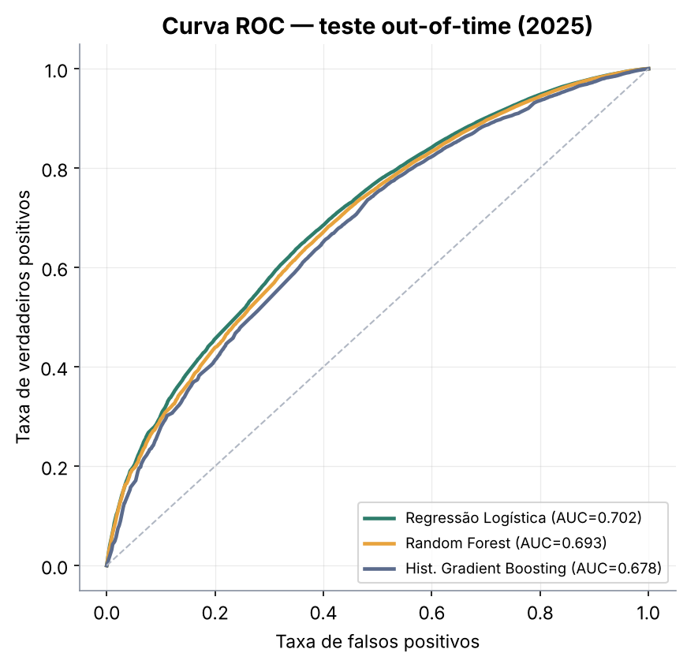
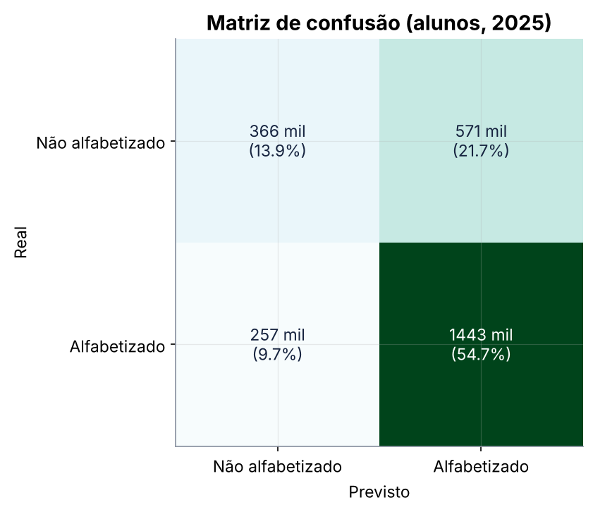
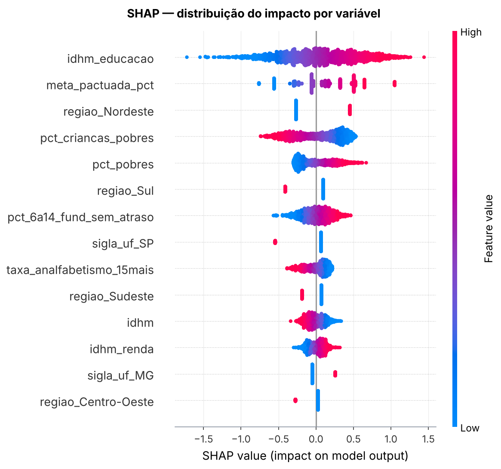
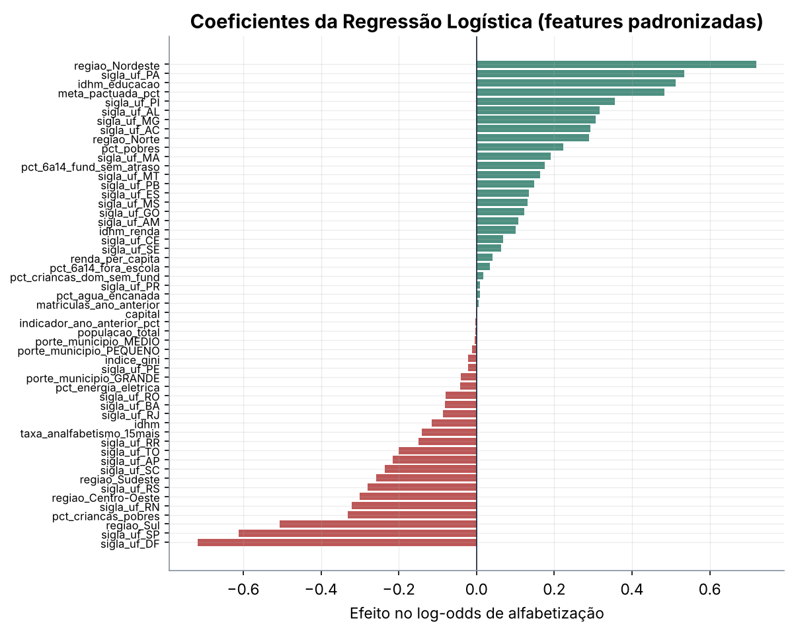
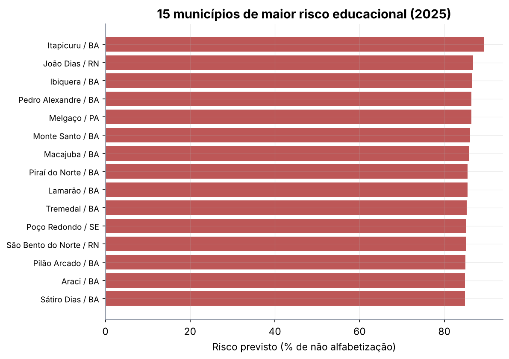

# Tech Challenge — Fase 3 · Predição e Inteligência Analítica para Alfabetização no Brasil

> Modelo supervisionado que prevê se uma criança do 2º ano do fundamental será
> **alfabetizada ou não**, a partir de variáveis educacionais, territoriais e
> socioeconômicas da camada **Gold** construída na Fase 2.

## 🎬 Apresentação em Vídeo

[](https://www.youtube.com/watch?v=koxZTN4x3tY)
<br> Pós Tech em Machine Learning Engineering — FIAP · Tech Challenge Fase 3.



---

## 1. Contexto do problema

A alfabetização na idade certa é um dos principais indicadores do desenvolvimento
educacional do país, e a média nacional esconde desigualdades enormes: em 2025, entre os
5.571 municípios da base, o indicador médio municipal vai de **41,9%** no quartil de menor
IDHM a **65,9%** no de maior, e de **48,3%** no Nordeste a **65,2%** no Centro-Oeste.
Olhar só o número atual não basta para decidir. Gestores públicos precisam **antecipar
risco**, identificar regiões vulneráveis e entender quais fatores mais pesam no resultado,
para levar apoio técnico ao município certo **antes** da próxima avaliação. Este projeto
transforma os dados públicos integrados na Fase 2 em inteligência analítica aplicada.

## 2. Objetivo analítico

Prever, para uma criança do 2º ano do ensino fundamental, a probabilidade de ela ser
**alfabetizada (1) ou não (0)**, usando apenas informação conhecida **antes** do ano
avaliado — contexto territorial, socioeconômico e histórico do município.

A feature store Gold é municipal (o alvo bruto é a *taxa* de alfabetização do município).
Para responder ao recorte binário por aluno do enunciado sem perder fidelidade nem
explodir volume, cada município-ano é representado por **duas linhas** (alfabetizado /
não) com `peso` igual ao número de alunos em cada classe. Treinar com
`sample_weight=peso` é matematicamente idêntico a expandir os **7,9 milhões** de alunos,
porém 237× menor; as métricas, ponderadas pelo peso, refletem a população real.

## 3. Descrição da base utilizada

Fonte primária: camada **Gold** da Fase 2 (`data/gold/`), tabela `features_ml_municipio`
(16.713 registros = 5.571 municípios × 2023, 2024 e 2025; 27 colunas), já construída
**sem vazamento** — nenhuma variável derivada do alvo entra como atributo. As contagens de
alunos por município-ano (`contagens_alunos_municipio.parquet`) dão o alvo binário e os
pesos.

As fontes IBGE, Atlas do Desenvolvimento Humano (Censo 2010) e série INEP/MEC são reais;
o grão municipal e os microdados de aluno são **simulação calibrada** (cada UF reproduz o
valor publicado), conforme declarado na Fase 2. O enriquecimento externo previsto no
enunciado (IBGE, Censo Escolar, FUNDEB, Atlas, PNAD, Cadastro Único) já está incorporado
ao contexto socioeconômico da Gold. A procedência está em [`data/README.md`](data/README.md).

## 4. Etapas de modelagem

Toda a preparação vive dentro de um `Pipeline` do Scikit-learn, garantindo que o
tratamento seja ajustado **só no treino** e viaje junto do estimador (replicabilidade):

- **Imputação** de numéricas pela mediana e de categóricas pela moda (`SimpleImputer`).
- **Transformação**: padronização das numéricas (modelos lineares) e **one-hot encoding**
  das categóricas (`sigla_uf`, `regiao`, `porte_municipio`).
- **Pré-processamento integrado ao modelo** via `ColumnTransformer` + `Pipeline`.
- **Tratamento de data leakage** em três camadas (ver seção 4.1).
- **Treino e validação** com três famílias de modelo e seleção pela validação cruzada.

### 4.1 Tratamento de data leakage

1. **Features ex-ante**: excluímos o indicador do próprio ano e as contagens que compõem o
   alvo. Também excluímos `variacao_ano_anterior_pp`, que depende de t-2 (indisponível em
   2023/2024), para não criar descasamento de disponibilidade entre treino e teste.
2. **Validação temporal (out-of-time)**: treino em **2023 + 2024**, teste em **2025** — o
   modelo prevê um ano inteiro que não viu.
3. **Validação cruzada por grupo de município** (`GroupKFold`): nenhum município aparece
   ao mesmo tempo em treino e validação de um fold, então o modelo não "decora" cidades.

## 5. Escolha do algoritmo

Comparamos três famílias, do mais interpretável ao mais expressivo, todas com o mesmo
pré-processamento e ponderação por aluno:

| Modelo | ROC-AUC (CV por município) | ROC-AUC (teste 2025) |
|---|---|---|
| **Regressão Logística** | **0,699 ± 0,010** | **0,702** |
| Random Forest | 0,694 ± 0,009 | 0,693 |
| Hist. Gradient Boosting | 0,690 ± 0,011 | 0,678 |

A **Regressão Logística** venceu na validação cruzada e generalizou melhor no ano não
visto, além de ser a mais transparente — um bom argumento em política pública, onde a
decisão precisa ser explicável. Foi o modelo final.

## 6. Métricas de avaliação

Modelo final no teste out-of-time de 2025 (ponderado por aluno):

| Métrica | Valor |
|---|---|
| ROC-AUC | **0,702** |
| PR-AUC | 0,800 |
| F1 | 0,777 |
| Precisão | 0,716 |
| Recall | 0,849 |
| Acurácia | 0,686 |
| Brier score | 0,203 |

Um AUC de 0,70 é um resultado **honesto**: prever alfabetização individual a partir de
contexto municipal é inerentemente ruidoso — a taxa do município limita o AUC alcançável,
já que todos os alunos de uma cidade compartilham o mesmo contexto. O valor está em
**ordenar** municípios e regiões por risco, não em cravar o resultado de cada criança.



## 7. Interpretação dos resultados

Feature Importance (permutação + coeficientes) e **SHAP Values** apontam para os mesmos
fatores estruturais:



As variáveis de maior influência são o **subíndice de educação do IDHM**
(`idhm_educacao`), a **meta pactuada**, pertencer ao **Nordeste**, e a **pobreza
infantil** (`pct_criancas_pobres`, `pct_pobres`). Municípios com mais educação acumulada e
menos pobreza têm probabilidade bem maior; o efeito regional persiste mesmo controlando
por renda e IDHM.



## 8. Insights encontrados

As perguntas de negócio do enunciado, respondidas pelos dados:

- **Quais fatores mais impactam a alfabetização?** Educação acumulada do município
  (`idhm_educacao`), pobreza infantil e região — mais do que a renda pura.
- **Quais municípios têm maior risco?** O ranking completo está em
  [`reports/municipios_risco_2025.csv`](reports/municipios_risco_2025.csv); **2.402**
  municípios têm risco majoritário (> 50% de não alfabetização prevista) em 2025. Os mais
  críticos concentram-se no Nordeste e Norte (ex.: Itapicuru/BA, João Dias/RN, Melgaço/PA).
- **Quais regiões têm padrões semelhantes?** Nordeste e Norte formam o grupo de menor
  desempenho; Sudeste, Sul e Centro-Oeste, o de maior.
- **Como prever quem pode não atingir metas futuras?** A validação temporal (treino até
  2024, previsão de 2025) é exatamente esse exercício: a probabilidade prevista, comparada
  à meta, antecipa os municípios em risco antes da avaliação.
- **Quais variáveis têm maior influência?** Ver seção 7 (SHAP e coeficientes).



## 9. Limitações do projeto

- O grão municipal e os microdados de aluno são **simulação calibrada** (Fase 2); as
  conclusões valem como demonstração metodológica, não como diagnóstico oficial.
- Como as features são **municipais**, todos os alunos de uma cidade recebem a mesma
  predição — o modelo captura risco **contextual**, não individual. Daí o teto de AUC.
- O contexto socioeconômico vem do **Censo 2010**; variáveis mais recentes (PNAD contínua,
  Censo 2022) melhorariam a atualidade.
- 21 municípios sem contexto socioeconômico são tratados por imputação.

## 10. Aplicação prática para políticas públicas

O modelo vira um **instrumento de priorização**: no início do ano letivo, ordena os
municípios pela probabilidade de não alfabetização e direciona apoio técnico e recursos
aos de maior risco **antes** da avaliação — em vez de reagir ao resultado no relatório do
ano seguinte. O ranking por UF e região também apoia a pactuação de metas realistas.

## 11. Possíveis evoluções futuras

- Incorporar dados por **escola/turma** (Censo Escolar) para sair do risco municipal para
  o individual.
- Atualizar o contexto com **Censo 2022** e **PNAD contínua**.
- Modelos hierárquicos (município dentro de UF) e calibração por região.
- Monitoramento do modelo em produção, com _drift_ de dados e re-treino anual.

---

## Como reproduzir

```bash
python -m venv .venv
# Windows:  .\.venv\Scripts\Activate.ps1
# Linux/Mac: source .venv/bin/activate
pip install -r requirements.txt

export PYTHONPATH=.            # Windows: $env:PYTHONPATH="."
python -m src.preprocessing.dataset      # monta o dataset a partir da Gold
python -m src.modeling.treinar           # treina, valida e salva o modelo final
python -m src.visualization.eda          # gráficos da análise exploratória
python -m src.visualization.resultados   # ROC, calibração, matriz, risco
python -m src.evaluation.interpretabilidade  # importância + SHAP
```

Ou rode o notebook `notebooks/analise_completa.ipynb`, que executa a pipeline inteira.

## Estrutura do repositório

```
tech-challenge-fase3/
├── data/gold/       # snapshots da camada Gold (origem documentada em data/README.md)
├── notebooks/       # analise_completa.ipynb
├── src/
│   ├── preprocessing/   # dataset.py (alvo + split) · pipeline.py (ColumnTransformer)
│   ├── modeling/        # modelos.py (candidatos) · treinar.py (CV + teste)
│   ├── evaluation/      # metricas.py · interpretabilidade.py (SHAP)
│   └── visualization/   # estilo.py · eda.py · resultados.py
├── reports/         # métricas, insights, ranking de risco, relatório e ADRs
├── images/          # figuras geradas
├── requirements.txt
├── README.md
└── .gitignore
```
